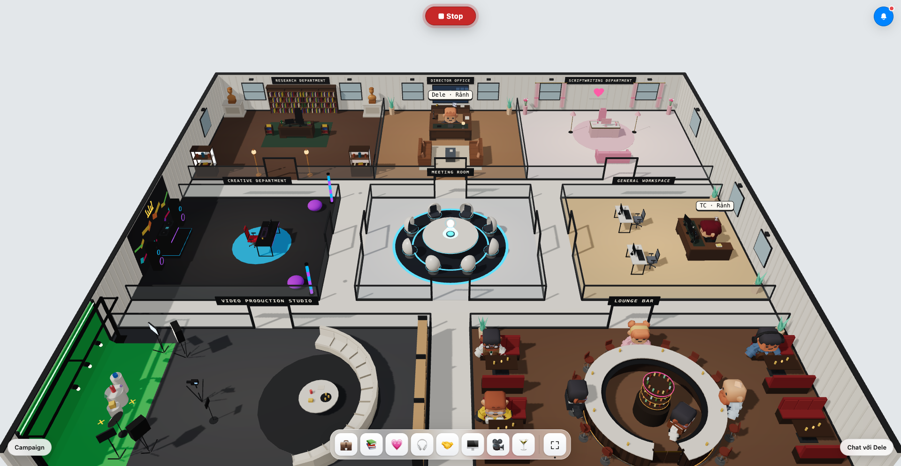

# 🍌 Dele Banana — Virtual AI Marketing Agency

> **Dele Banana** là một **công ty Marketing ảo chạy bằng AI**: người dùng đóng vai chủ doanh nghiệp, điều hành chiến dịch marketing thông qua đội ngũ nhân viên AI chuyên biệt (Director, Coordinator, Nghiên cứu, Biên kịch, Sáng tạo, Sản xuất Video, Đăng bài, Phân tích) hiện diện trực quan trong một **văn phòng 3D ảo (Stylized 3D Virtual Office)**.

---

<p align="center">
  
</p>

<p align="center">
  <em>Ảnh chụp thực tế văn phòng 3D của Dele Banana — 8 phòng, mỗi nhân vật AI hiển thị đúng trạng thái backend thời gian thực (ví dụ “Dele · Rảnh”, “TC · Rảnh”).</em>
</p>

---

## 🌟 Ba Trụ Cột Cốt Lõi

| Trụ cột | Mô tả | Công nghệ & Triển khai |
|---|---|---|
| **🤖 AI Agent Orchestration** | Đội ngũ Agent phối hợp nhịp nhàng: **Director** là đầu mối giao tiếp duy nhất; **Coordinator** lập kế hoạch, phân chia task và nghiệm thu; các **Agent chuyên môn** (An nghiên cứu, Hà biên kịch, Bình sáng tạo, Video Producer, Publisher, Analyst) thực thi công việc. | CLI Harness Gateway (Claude Code / Gemini CLI qua gói thuê bao), State Machine hữu hạn, Hàng đợi nhiệm vụ. |
| **🏢 3D Virtual Office** | Không gian văn phòng 3D isometric stylized (Kenney low-poly assets) gồm 8 phòng thuộc 6 khu vực chức năng. Mọi di chuyển, cử chỉ (gõ phím, thảo luận, họp, nghỉ ngơi) đều phản ánh trạng thái thực từ Event Bus backend. | Three.js qua React Three Fiber + Drei, Perspective Camera 38° FOV, Soundscape, Event Bus thời gian thực qua Server-Sent Events (SSE). |
| **🚀 Marketing Automation** | Tự động hóa trọn gói vòng đời chiến dịch: Nghiên cứu thị trường & đối thủ → Brainstorm ý tưởng & 3 kịch bản khác biệt → Sản xuất video ngắn 9:16 (Veo/Gemini) → Phê duyệt & Đăng tự động lên TikTok, Facebook Reels, Instagram Reels → Đo lường phân tích hiệu suất. | Hono backend, SQLite (Drizzle ORM), Meta Graph API (Facebook Reels + Instagram Reels Resumable Upload), SSE Event Bus. |

---

## 🗺️ Bố Cục Văn Phòng 3D & Đội Ngũ Nhân Viên

Văn phòng gồm **8 phòng** xếp thành 3 dãy (bắc → nam), nối với nhau bằng hành lang chữ thập. Đồ đạc trong các phòng riêng tuân thủ quy tắc đối xứng nghiêm ngặt (xem [docs/design/05-office-decor.md](docs/design/05-office-decor.md)). Về mặt domain, các phòng thuộc 6 khu vực chức năng (Research, Creative, Scriptwriting, Video Studio, Meeting Room, General Workspace); Phòng Giám đốc và Lounge Bar là phòng hiển thị riêng.

```text
┌──────────────────────┬──────────────────┬──────────────────────┐
│ 📚 Research          │ 🏢 Director      │ ✍️ Scriptwriting      │  Dãy bắc
│    Department        │    Office        │    Department        │
├────────────────┬─────┴──────────────────┴─────┬────────────────┤
│ 🎨 Creative    │       👥 Meeting Room        │ 💼 General     │  Dãy giữa
│    Department  │                              │    Workspace   │
├────────────────┴──────────────┬───────────────┴────────────────┤
│ 🎬 Video Production Studio    │ 🍸 Lounge Bar                  │  Dãy nam
└───────────────────────────────┴────────────────────────────────┘
```

1. **📚 Research Department** — do **An (Học giả)** phụ trách: sàn gỗ óc chó tối màu, thảm xanh rêu, bàn óc chó có đèn banker, tủ sách lớn giữa hai cửa sổ, hai tượng bán thân màu đồng. Nghiên cứu xu hướng, đối thủ và chân dung khách hàng.
2. **🏢 Director Office** — bàn làm việc của **Director (Dele)**, đầu mối duy nhất trò chuyện với người dùng qua khung "Chat với Dele".
3. **✍️ Scriptwriting Department** — do **Hà (Sang trọng)** phụ trách: sàn gỗ trắng hồng, thảm tròn hồng, bàn đá trắng viền vàng, tim neon và sofa hồng. Soạn thảo 3 phương án kịch bản độc lập.
4. **🎨 Creative Department** — do **Bình (Hiphop)** phụ trách: sàn bê tông đen, bục DJ với hai loa, graffiti và vương miện neon, bàn đen viền LED trên thảm xanh neon, hai ghế lười tím. Định hình góc tiếp cận thị giác và hook video.
5. **👥 Meeting Room** — bàn họp tròn ở trung tâm văn phòng; khi Trưởng phòng chia việc (`planning`) hoặc nghiệm thu (`reviewing`), cả đội (trừ Giám đốc) vào ngồi quanh bàn.
6. **💼 General Workspace** — bàn chữ U của Trưởng phòng **Coordinator (TC)** cùng các bàn cho **Publisher** (Đăng bài) và **Analyst** (Phân tích).
7. **🎬 Video Production Studio** — do **Video Producer** phụ trách: phông xanh chroma key, máy quay trên tripod, đèn softbox, sofa vòng cung. Video Producer đứng sau máy quay.
8. **🍸 Lounge Bar** — quầy bar tròn ở giữa, booth ghế da; Agent rảnh (`idle`) ra đây nghỉ, Lounge hết chỗ thì về bàn của mình.

Thanh **Dock** ở cạnh dưới màn hình cho phép bay camera tới từng phòng; nút **Campaign** mở danh sách chiến dịch.

---

## 🏗️ Cấu Trúc Dự Án (Monorepo)

Dự án sử dụng mô hình monorepo chuẩn quản lý bằng `pnpm workspace`:

```text
delebanana/
├── apps/
│   ├── web/                     # Frontend: React, Vite, React Three Fiber (3D Office), Zustand UI
│   │   ├── src/
│   │   │   ├── office/          # Bố cục 3D, đường đi nhân vật, đồ đạc, cử chỉ animation
│   │   │   ├── scene/           # Component R3F: Tòa nhà, nội thất, nhân vật, ánh sáng
│   │   │   ├── ui/              # Giao diện người dùng: Chat với Director, Duyệt bài, Danh sách chiến dịch
│   │   │   └── live/            # Kết nối Event Bus SSE thời gian thực từ Server
│   │   └── public/models/       # 3D Assets CC0 (Kenney Mini Characters 2.0 & Furniture Kit)
│   └── server/                  # Backend: Node.js, Hono, Drizzle ORM (SQLite), Event Bus, Meta API
│       ├── src/
│       │   ├── core/            # Đơn vị công việc (Unit of Work), Máy trạng thái, Event Bus
│       │   ├── agents/          # CLI Harness Gateway, Prompts, Runtime điều phối nhân viên AI
│       │   ├── campaign/        # Luồng nghiệp vụ chiến dịch, phê duyệt kịch bản & video
│       │   ├── publish/         # Đăng bài Meta Graph API (Facebook Reels & Instagram Reels)
│       │   └── http/            # API Endpoints (Hono) & SSE Stream
│       └── drizzle/             # Database migrations
├── packages/
│   └── domain/                  # Lõi dùng chung: Mô hình dữ liệu thuần túy, State Machine, Sự kiện
│       └── src/
│           ├── lifecycle/       # Vòng đời Campaign, Task, Approval, VideoVersion, Post
│           └── states.ts        # Định nghĩa trạng thái và hành vi của Agent
├── docs/                        # Tài liệu phân tích, thiết kế kỹ thuật, lộ trình sản phẩm
└── package.json
```

---

## ⚡ Cài Đặt và Khởi Chạy

### Yêu Cầu Môi Trường
- **Node.js**: phiên bản `>= 20.0.0`
- **pnpm**: phiên bản `12.x` (khuyến nghị `pnpm@12.11.2`)

### 1. Cài đặt dependencies
```bash
pnpm install
```

### 2. Khởi chạy môi trường phát triển
Mở hai terminal hoặc chạy đồng thời:

```bash
# Terminal 1: Chạy Backend Server (cổng 3000)
pnpm server

# Terminal 2: Chạy Frontend Web & Văn phòng 3D (cổng 5173)
pnpm dev
```

Truy cập giao diện tại: `http://localhost:5173`

### 3. Chạy kiểm thử tự động (Vitest)
Dự án được bảo vệ bởi bộ kiểm thử tự động toàn diện:
```bash
pnpm test
```
> Hiện tại toàn bộ **54 suites** và **589 unit/integration tests** đều vượt qua (`passed`).

---

## 📚 Hệ Thống Tài Liệu Kỹ Thuật

Toàn bộ tài liệu chi tiết được lưu trữ trong thư mục [`docs/`](docs/):

### 1. Phân Tích Sản Phẩm (`docs/product/`)
- [README.md](docs/product/README.md) — Tổng quan phân tích nghiệp vụ Dele Banana.
- [modules.md](docs/product/modules.md) — Phân rã 14 module hệ thống (M1..M14) và bảng truy vết tính năng.
- [roadmap.md](docs/product/roadmap.md) — Lộ trình triển khai, danh sách 18 quyết định kỹ thuật đã chốt (D-1..D-18).
- [boundaries.md](docs/product/boundaries.md) — Ranh giới rõ ràng: AI Agent / API bên ngoài / Backend / Hoạt ảnh 3D.
- [platform-limits.md](docs/product/platform-limits.md) — Bảng đối chiếu giới hạn API TikTok, Meta, dịch vụ sinh video.
- [risks.md](docs/product/risks.md) — Ma trận rủi ro kỹ thuật, chính sách nền tảng, chi phí và sản phẩm.

### 2. Thiết Kế Hệ Thống (`docs/design/`)
- [01-domain-model.md](docs/design/01-domain-model.md) — Mô hình thực thể: Workspace, Campaign, Agent, Task, Approval, Video.
- [02-lifecycle-events.md](docs/design/02-lifecycle-events.md) — Máy trạng thái hữu hạn và hợp đồng sự kiện miền qua Event Bus.
- [03-permissions-approvals-audit.md](docs/design/03-permissions-approvals-audit.md) — Ma trận phân quyền, kiểm soát hạn mức, luồng duyệt và nhật ký.
- [04-memory.md](docs/design/04-memory.md) — Thiết kế bộ nhớ Agent (ngắn hạn, dài hạn, phân tách theo Campaign).
- [05-office-decor.md](docs/design/05-office-decor.md) — Bộ quy tắc thiết kế nội thất và tính đối xứng trong văn phòng 3D.

### 3. Hướng Dẫn & Nghiên Cứu (`docs/guides/` & `docs/research/`)
- [meta-app-setup.md](docs/guides/meta-app-setup.md) — Hướng dẫn chi tiết tạo App Meta để đăng video Facebook & Instagram Reels.
- [2026-11-23-next-steps-video-publish.md](docs/research/2026-11-23-next-steps-video-publish.md) — Nghiên cứu tích hợp nguồn video và xuất bản đa kênh.
- [2026-11-18-s5-cli-spike.md](docs/research/2026-11-18-s5-cli-spike.md) — Kết quả thực nghiệm điều khiển CLI qua gói thuê bao.

---

## 🛡️ Nguyên Tắc Thiết Kế Không Chi Phí Phụ (D-14)
- **Tận dụng tối đa tài nguyên có sẵn**: Dùng gói thuê bao LLM (Claude Code / Gemini) qua CLI chính chủ thay vì nạp API key trả theo token.
- **Không dịch vụ trả phí**: Không dùng proxy, SaaS trung gian, tên miền trả phí hoặc dịch vụ sinh video tốn tiền trong giai đoạn MVP.
- **Tất định & An toàn**: Quyền hạn được kiểm tra nghiêm ngặt tại backend trước khi thực thi bất kỳ tác vụ nào ra môi trường bên ngoài.

---
*Bản quyền © 2026 Dele Banana Team.*
