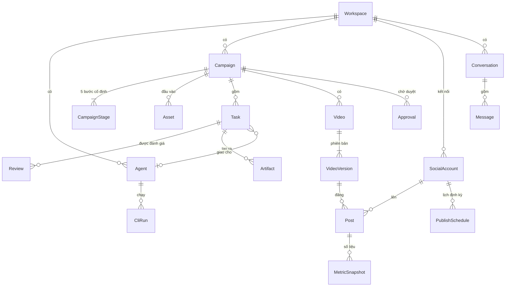

# Thiết kế 1 — Mô hình dữ liệu

Ngày: 2026-11-18. Giai đoạn 2 (thiết kế), không gồm UI. Dựa trên [docs/product](../product/README.md) và các quyết định
D-1..D-14 trong [roadmap.md](../product/roadmap.md).

Các thiết kế khác của Giai đoạn 2 dựa trên tài liệu này: (2) vòng đời trạng thái và sự kiện, (3) quyền hạn, phê duyệt,
nhật ký, (4) bộ nhớ. Chỗ ghi **→ TK2/TK3/TK4** là phần được chi tiết ở tài liệu đó; **chờ S5** là phần phụ thuộc spike chưa làm.

## 1. Mục đích và ràng buộc

Mô hình dữ liệu là nền của backend (M1–M11, M14): định nghĩa thực thể, quan hệ, bất biến và nơi lưu.

Ràng buộc đã chốt:
- Một người dùng, chạy cục bộ (D-8). Không có tài khoản người dùng, thành viên hay phân quyền người dùng.
- LLM chỉ qua CLI chính chủ dùng gói thuê bao (D-7, D-9); **không API trả phí nào** (D-14). Không có thực thể "chi phí tiền".
- Video: provider `manual` (người dùng tự sinh trong app Gemini/Flow rồi tải lên) và `template` (Remotion/ffmpeg) (D-13);
  một lần sinh = một video 9:16 = một phiên bản (D-2).
- SQLite qua Drizzle, tệp trên đĩa (D-10). Kiểu dùng chung giữa backend và frontend nằm trong `packages/` (như `packages/domain`).

## 2. Hướng đã chọn

| Câu hỏi | Đã chọn (người dùng, 2026-11-18) | Bị loại |
|---|---|---|
| Nhiều Campaign chạy cùng lúc trong một Workspace | **Mỗi Agent một task tại một thời điểm.** Campaign chạy song song, dùng chung đội Agent của Workspace; task xếp hàng chờ Agent rảnh | Một Campaign mỗi Workspace (chặn cả khi Campaign đang chờ duyệt); Agent chạy nhiều task song song (phá "một nhân vật một chỗ" của 3D, tốn hạn mức) |
| Campaign chạy theo khung nào | **Khung 5 bước cố định** (Nghiên cứu → Kịch bản → Video → Đăng → Phân tích) với điểm duyệt cố định giữa các bước; trong mỗi bước Coordinator tự chia task và giao người | Coordinator tự lập toàn bộ kế hoạch: khó đoán, khó kiểm thử, LLM có thể bỏ qua điểm duyệt |

## 3. Quy ước chung

- **Khoá chính:** ULID dạng chuỗi (sắp theo thời gian tạo, sinh được ở client và server).
- **Thời gian:** số nguyên mili giây epoch (UTC). Lịch đăng lưu thêm múi giờ IANA.
- **Xoá:** Workspace, Agent, SocialAccount xoá mềm (`archivedAt`) vì nhật ký và số liệu cũ còn tham chiếu. Thực thể khác không xoá khi đã có nhật ký tham chiếu.
- **Nội dung dài** (kết quả nghiên cứu, kịch bản, log CLI) lưu trong cột JSON/Markdown nếu nhỏ; tệp lớn (video, ảnh, log thô) lưu trên đĩa, DB giữ đường dẫn tương đối.
- **Thư mục dữ liệu** *(đề xuất)*: `<dataDir>/db.sqlite` và `<dataDir>/workspaces/<workspaceId>/campaigns/<campaignId>/{assets,videos,renders}/`; `logs/cli/<runId>.jsonl`. `dataDir` cấu hình được, mặc định trong thư mục dữ liệu ứng dụng của người dùng.

## 4. Thực thể

### 4.1 Tổ chức

**Workspace** — ranh giới thương hiệu/sản phẩm/dự án.

| Trường | Ý nghĩa |
|---|---|
| `name` | Tên |
| `brandProfile` | JSON: mô tả sản phẩm/thương hiệu, giọng điệu, đối tượng mặc định, từ khoá cấm |
| `limits` | Hạn mức mềm (D-5): số lượt CLI chạy đồng thời, số lượt/ngày theo provider, ngưỡng cảnh báo → TK3 |
| `archivedAt` | Xoá mềm |

**Agent** — "nhân viên" AI, thuộc đúng một Workspace.

| Trường | Ý nghĩa |
|---|---|
| `workspaceId` | Workspace sở hữu |
| `roleTemplate` | `director`, `coordinator`, `researcher`, `creative`, `scriptwriter`, `video_producer`, `publisher`, `analyst` (khớp `AgentRole` của `packages/domain`); quyết định loại task Agent nhận được |
| `title` | Chức danh tự do (vai trò không giới hạn, D-5): ví dụ "Trend Researcher", "Competitor Researcher" cùng template `researcher` |
| `name`, `appearance` | Tên và ngoại hình (model nhân vật; trang phục sau) — dùng bởi M12 |
| `provider`, `model` | `claude` hoặc `gemini` (D-9); tên model do CLI chấp nhận |
| `systemPrompt` | Prompt riêng, ghép với prompt mẫu của template |
| `tools` | Danh sách công cụ cho phép (web search, đọc tệp, …) — ánh xạ sang cờ của CLI, **chờ S5** |
| `permissions` | Quyền hạn hành động → TK3 |
| `enabled` | Tắt = trạng thái `offline` |
| `archivedAt` | Xoá mềm |

Bất biến:
- **Đội mặc định khi tạo Workspace (D-18): 8 Agent** — `director`, `coordinator`, `researcher`, `analyst`, `creative`, `scriptwriter`, `video_producer`, `publisher`, đều dùng Claude (D-15). Mức mặc định/tối đa mỗi phòng: Research 2/4, Creative 1/2, Scriptwriting 1/2, Video Studio 1/2, General Workspace 2/4, Director Office 1/1 (`STAFFING` trong `packages/domain`); đây là gợi ý phân bổ và sức chứa bàn, không phải giới hạn cứng (D-5).
- *(đề xuất)* Mỗi Workspace đang hoạt động có **đúng một** Agent `director` và **đúng một** `coordinator`; không xoá được hai Agent này, chỉ sửa cấu hình. Agent chuyên môn không giới hạn.
- Trạng thái chạy của Agent (`idle`, `researching`, …) **không lưu** trong bảng Agent: suy ra từ task/lượt CLI đang chạy và phát qua Event Bus → TK2. Bảng chỉ lưu cấu hình.
- "Nhân bản Agent" = tạo Agent mới chép cấu hình, không chép bộ nhớ (bộ nhớ → TK4).

### 4.2 Chiến dịch

**Campaign**

| Trường | Ý nghĩa |
|---|---|
| `workspaceId` | |
| `title` | |
| `brief` | JSON: mục tiêu, đối tượng mục tiêu, sản phẩm, thông điệp, nền tảng đích, số video, ràng buộc. Director điền dần qua hội thoại |
| `stages` | Danh sách bước sẽ chạy, theo thứ tự cố định: luôn có `research`, `scripting`; `video`, `publishing`, `analytics` có thể bỏ (chiến dịch chỉ cần kịch bản) |
| `status` | `briefing` → `active` → `completed`; có `paused`, `cancelled` → TK2 |
| `currentStage` | Bước đang chạy |

**CampaignStage** — một bước của khung cố định, mỗi Campaign có một bản ghi cho từng bước trong `stages`.

| Bước | Agent chính | Điểm duyệt khi kết thúc bước |
|---|---|---|
| `research` | researcher (nhiều), Coordinator tổng hợp | Không (Director trình bày tóm tắt, người dùng có thể góp ý) |
| `scripting` | creative, scriptwriter | **Chọn kịch bản** (từ 3 kịch bản, D-2 không ghép) |
| `video` | video_producer | Với `manual`: **Tạo video** (chờ người dùng tải lên); mọi provider: **Duyệt video** |
| `publishing` | publisher | **Duyệt đăng** (có cho mọi nền tảng; tự động đăng theo lịch chỉ sau khi đã duyệt, D-3) |
| `analytics` | analyst | Không (đề xuất cải thiện chỉ là đề xuất, M5) |

Trường: `campaignId`, `stage`, `status` (`pending` → `running` → `awaiting_approval` → `done`; hoặc `skipped`) → TK2, `startedAt`, `endedAt`, `summary`.

Bất biến: bước sau chỉ bắt đầu khi bước trước `done`/`skipped`. Điểm duyệt do backend đặt theo bảng trên, **không do LLM quyết định**.

*(đề xuất)*
- **Số video:** khi chọn kịch bản, người dùng chọn một hoặc nhiều trong 3 kịch bản; mỗi kịch bản được chọn thành một `Video`.
- **Bước `analytics`:** xong khi có báo cáo phân tích đầu tiên. Việc thu số liệu định kỳ chạy tiếp độc lập với bước (theo `Post`),
  và báo cáo sau được tạo theo yêu cầu hoặc theo lịch.

**Asset** — tài sản đầu vào của Campaign: `kind` (`image`, `video`, `link`, `text`), `path` hoặc `url`, `note`, `addedBy` (`user`/agentId).

### 4.3 Công việc

**Task** — việc Coordinator giao, thuộc một bước của một Campaign.

| Trường | Ý nghĩa |
|---|---|
| `campaignId`, `stage` | |
| `kind` | Loại việc, ràng buộc với template: `research.trend`, `research.competitor`, `research.audience`, `research.synthesis`, `ideation`, `script`, `video.prompt`, `video.template_render`, `caption`, `publish`, `analysis`, … |
| `requiredRole` | Template cần có để nhận việc |
| `assigneeAgentId` | Agent cụ thể; để trống = Agent rảnh nào có `requiredRole` cũng được (bộ xếp lịch gắn khi giao) |
| `input` | JSON: chỉ dẫn của Coordinator, tham chiếu Asset/Artifact |
| `dependsOn` | Danh sách Task phải xong trước (trong cùng Campaign) |
| `priority` | Số nguyên; mặc định theo thứ tự Campaign |
| `status` | `queued` → `assigned` → `running` → `in_review` → `done`; vòng làm lại về `queued`; `waiting` (chờ việc bên ngoài: người dùng tải video, render); `failed`, `cancelled` → TK2 |
| `attempt` | Lần thử hiện tại (bắt đầu 1) |
| `outputArtifactIds` | Sản phẩm của task |

Hàng đợi (theo hướng đã chọn): mỗi Agent tối đa một task `assigned`/`running`, và *(đề xuất)* tối đa **một lượt CLI chạy
cùng lúc** kể cả lượt không gắn task (chat, tổng hợp của Coordinator, trả lời của Director); tin nhắn đến khi Agent bận thì xếp hàng. Bộ xếp lịch chọn task `queued` đã đủ phụ thuộc,
theo `priority` rồi thời gian tạo, cho Agent rảnh phù hợp, trong giới hạn lượt CLI đồng thời của Workspace (D-5) → TK2, TK3.

**Review** — Coordinator đánh giá đầu ra: `taskId`, `attempt`, `verdict` (`pass`, `pass_with_limits`, `rework`), `feedback`, `limits` (giới hạn được chấp nhận khi `pass_with_limits`), `cliRunId`.
*(đề xuất)* Tối đa **2 lần làm lại** (`attempt` ≤ 3); quá thì task `failed` và Director báo người dùng.

**Artifact** — sản phẩm của task, có phiên bản theo `attempt`.

| `kind` | Nội dung |
|---|---|
| `research_report` | Markdown + danh sách phát hiện; **mỗi phát hiện có nguồn và độ tin cậy** (D-4) |
| `research_synthesis` | Tổng hợp của Coordinator |
| `idea_set` | Ý tưởng brainstorm |
| `script` | Một kịch bản: hook, cảnh, lời thoại/chữ trên hình, độ dài dự kiến, gợi ý nhạc. Bước `scripting` tạo **3 kịch bản khác biệt** |
| `video_prompt` | Prompt video + Asset ảnh tham chiếu (cho provider `manual`) |
| `render_spec` | Bố cục cho template Remotion/ffmpeg |
| `caption` | Caption + hashtag theo nền tảng |
| `analysis` | Nhận định và đề xuất của Analytics Agent |

Trường chung: `taskId`, `campaignId`, `kind`, `content` (JSON), `createdByAgentId`, `createdAt`.

### 4.4 Video (M7)

**Video** — một video của Campaign, sinh từ kịch bản đã chọn: `campaignId`, `scriptArtifactId`, `title`.

**VideoVersion** — mỗi lần sinh/sửa/tạo lại = một phiên bản mới (D-2).

| Trường | Ý nghĩa |
|---|---|
| `videoId`, `number` | Số thứ tự 1, 2, 3… |
| `provider` | `manual` hoặc `template` (D-13, D-14) |
| `basedOnVersionId` | Phiên bản gốc khi sửa/tạo lại |
| `promptArtifactId` / `renderSpecArtifactId` | Đầu vào |
| `status` | `requested` → (`awaiting_upload` với `manual` / `rendering` với `template`) → `ready` → `approved` hoặc `rejected`; `invalid` khi tệp sai chuẩn → TK2 |
| `filePath`, `durationMs`, `width`, `height`, `sizeBytes` | Tệp đã nhận |
| `validation` | Kết quả kiểm: tỉ lệ 9:16, thời lượng, định dạng (hệ quả D-13) |

### 4.5 Người dùng quyết định

**Approval** — điểm dừng chờ người dùng.

| Trường | Ý nghĩa |
|---|---|
| `campaignId` | Có thể trống (vd. hành động ngoài quyền không gắn Campaign) |
| `kind` | `choose_script`, `make_video` (provider `manual`: người dùng sinh video và tải lên), `approve_video`, `approve_publish`, `strategy_change` (đổi brief/chiến lược khi Campaign đã chạy, TK3), `out_of_permission`, `limit_override` |
| `subject` | Tham chiếu đối tượng cần duyệt (danh sách Artifact kịch bản, VideoVersion, Post, hành động) |
| `requestedByAgentId` | Thường là Director |
| `status` | `pending` → `approved` / `rejected` / `changes_requested`; `expired` khi đối tượng không còn hiệu lực |
| `decision` | JSON: lựa chọn (vd. kịch bản nào), ghi chú của người dùng |

Chi tiết quy tắc và hành động nào bắt buộc duyệt → TK3.

**Conversation / Message**
- *(đề xuất)* Mỗi Workspace một hội thoại với Director; tin nhắn có thể gắn `campaignId`. Mỗi Agent chuyên môn một hội thoại riêng (tab Chat).
- `Message`: `conversationId`, `role` (`user`, `agent`, `system`), `agentId`, `campaignId`, `content`, `kind` (`chat`, `question`, `proposal_to_director`).
- D-1: tin nhắn ở hội thoại Agent chuyên môn mà là yêu cầu việc mới được chuyển thành `proposal_to_director` trong hội thoại Director, không tạo Task trực tiếp.

### 4.6 Đăng bài và số liệu (M8, M9)

**SocialAccount** — tài khoản mạng xã hội đã kết nối, thuộc một Workspace; mỗi nền tảng nhiều tài khoản.

| Trường | Ý nghĩa |
|---|---|
| `platform` | `tiktok`, `facebook`, `instagram` |
| `externalId`, `displayName` | |
| `credentialRef` | *(đề xuất)* Token OAuth lưu trong macOS Keychain, DB chỉ giữ khoá tham chiếu |
| `capabilities` | Quyền đã cấp; với TikTok: app đã audit hay chưa (quyết định đăng tự động hay Upload nháp, D-3) |
| `status` | `connected`, `expired`, `revoked` |

**Post** — một phiên bản video đăng lên một tài khoản.

| Trường | Ý nghĩa |
|---|---|
| `videoVersionId`, `socialAccountId`, `campaignId` | |
| `captionArtifactId` | |
| `mode` | `publish` hoặc `draft_upload` (TikTok chưa audit hoặc thiếu đồng ý, D-3) |
| `tiktokConsent` | Với TikTok: xác nhận quyền riêng tư/đồng ý theo từng bài (D-3) |
| `scheduledAt`, `timezone`, `scheduleId` | |
| `status` | `draft` → `awaiting_approval` → `scheduled` → `publishing` → `published` / `draft_uploaded`; `failed` → TK2 |
| `platformPostId`, `publishedAt`, `error` | |

**PublishSchedule** — lịch đăng định kỳ *(đề xuất cho MVP)*: `socialAccountId`, `rule` (tập con: các ngày trong tuần + giờ, múi giờ),
`queue` (danh sách VideoVersion đã duyệt chờ đăng theo thứ tự). Mỗi lần đến giờ tạo một `Post` cho phiên bản kế tiếp trong hàng.
Lịch một lần chỉ là `Post.scheduledAt`, không cần PublishSchedule. Phiên bản trong `queue` đã qua **Duyệt đăng**, nên Post sinh
từ lịch đăng không cần duyệt lại với Facebook/Instagram; với TikTok vẫn cần xác nhận đồng ý từng bài, chưa có thì Upload nháp (D-3).

**MetricSnapshot** — số liệu bài đăng theo thời điểm: `postId`, `capturedAt`, `views`, `likes`, `comments`, `shares`.
**AccountSnapshot** — `socialAccountId`, `capturedAt`, `followers`.
Engagement Rate **không lưu**: tính khi đọc = (likes + comments + shares) / views, theo từng snapshot.

### 4.7 Vận hành (M4, M10)

**CliRun** — một lượt chạy CLI (một lượt Agent, D-7). **chờ S5** cho trường cụ thể.

| Trường | Ý nghĩa |
|---|---|
| `agentId`, `taskId` (có thể trống: chat, tổng hợp), `campaignId` | |
| `provider`, `model`, `cliVersion` | |
| `purpose` | `task`, `review`, `chat`, `planning`, `briefing` |
| `startedAt`, `endedAt`, `exitCode`, `outcome` (`ok`, `error`, `quota_exhausted`, `timeout`) | |
| `usage` | JSON: token vào/ra, số lượt — tuỳ CLI báo gì |
| `logPath` | Đầu ra stream JSON thô |

Cost Management (M10) chỉ đọc `CliRun.usage` và đếm `VideoVersion` theo provider; **không có trường tiền** (D-14).

**Meeting** — phiên trao đổi thật giữa ≥ 2 Agent (điều kiện của trạng thái `in_meeting`) → TK2 mục 4.7.

Nhật ký hành động (AuditEntry) → TK3. Bộ nhớ (MemoryItem) → TK4.

## 5. Sơ đồ quan hệ

## 6. Còn mở

| Mục | Phụ thuộc |
|---|---|
| Trường `tools` của Agent ánh xạ sang cờ CLI; trường `usage` của CliRun | **S5** |
| Quyền OAuth cụ thể, TikTok audit, redirect `localhost` | **S2** |
| Giới hạn thời lượng/định dạng khi kiểm `VideoVersion` (`manual` từ Gemini/Flow) | **S3** |
| Vòng đời trạng thái chi tiết và sự kiện | TK2 |
| Quyền hạn Agent, quy tắc bắt buộc duyệt, nhật ký | TK3 |
| Bộ nhớ riêng/chung/theo Campaign | TK4 |

## 7. Để lại cho người dựng

Tên bảng/cột, chỉ mục, cách tách JSON thành bảng con khi cần truy vấn, migration Drizzle, cách sinh ULID.
