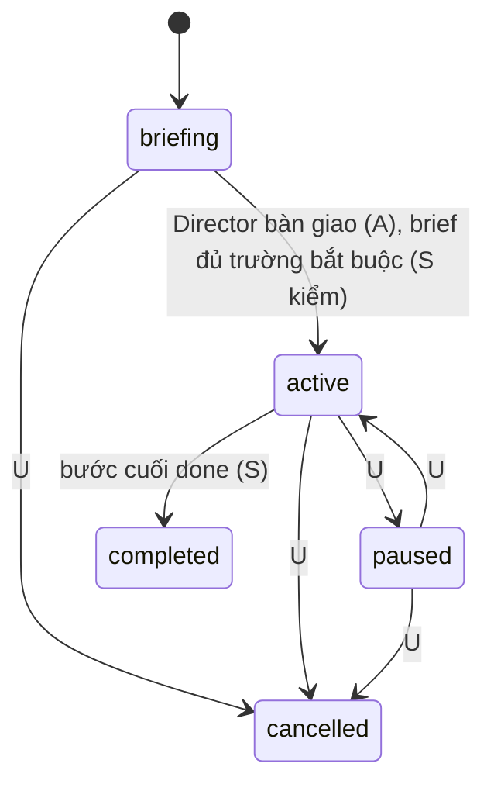
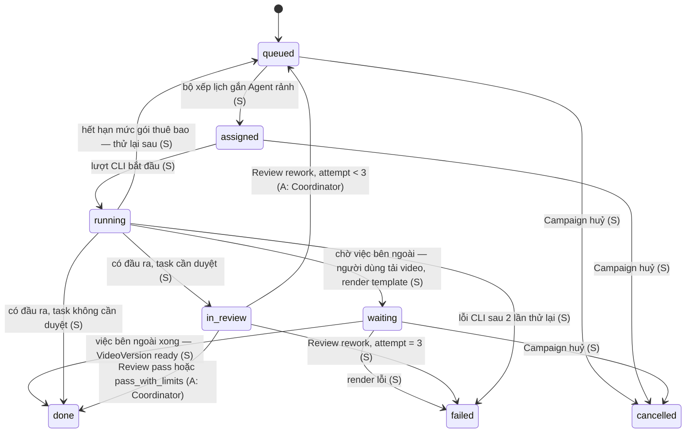

# Thiết kế 2 — Vòng đời trạng thái và sự kiện

Ngày: 2026-11-18. Giai đoạn 2, không gồm UI. Dựa trên [TK1 — Mô hình dữ liệu](01-domain-model.md) và
[boundaries.md](../product/boundaries.md) mục 2 (trạng thái Agent → khu → animation).

## 1. Mục đích

- Định nghĩa đường chuyển trạng thái hợp lệ của Campaign, CampaignStage, Task, VideoVersion, Post, Approval: chuyển nào được phép, ai kích hoạt.
- Định nghĩa cách suy ra trạng thái Agent (17 trạng thái trong `packages/domain`) từ dữ liệu thật — 3D chỉ hiển thị trạng thái này (boundaries.md).
- Định nghĩa sự kiện của Event Bus (M11): nguồn duy nhất cho 3D, tab Logs, tab Status; chống lệch trạng thái (rủi ro T4).

## 2. Hướng đã chọn

| Câu hỏi | Đã chọn (người dùng, 2026-11-18) | Bị loại |
|---|---|---|
| Quan hệ giữa sự kiện và dữ liệu SQLite | **Bảng dữ liệu là nguồn sự thật; mỗi lần đổi trạng thái cập nhật bản ghi và ghi một dòng vào bảng `events` (số thứ tự tăng dần) trong cùng một giao dịch.** Event Bus phát từ bảng này; UI mất kết nối thì lấy snapshot rồi nhận tiếp từ `seq` cuối | Event sourcing đầy đủ: quá phức tạp cho ứng dụng một người dùng, khó đổi cấu trúc sự kiện; sự kiện chỉ trong bộ nhớ: mất lịch sử tab Logs, dễ lệch trạng thái |

## 3. Nguyên tắc chung

- **Mọi đổi trạng thái đi qua một hàm duy nhất** `transition(entity, to, actor, data)`: kiểm đường chuyển theo bảng ở mục 4, cập nhật bản ghi, ghi sự kiện, tất cả trong một giao dịch SQLite. Không cập nhật cột `status` ở chỗ khác.
- **Tác nhân (`actor`):**
  - `user` — người dùng thao tác trong UI.
  - `system` — backend tất định (bộ xếp lịch, hết giờ, kiểm tệp, kết thúc lượt CLI).
  - `agent:<id>` — LLM yêu cầu qua công cụ (tool) mà backend cung cấp; backend vẫn kiểm đường chuyển và quyền (→ TK3). LLM **không** tự đặt điểm duyệt hay bỏ qua nó.
- **Đường chuyển sai bị từ chối** (lỗi, không ghi sự kiện). Mã thuần (state machine) nằm trong package dùng chung, có kiểm thử cho mọi cặp trạng thái.

## 4. Vòng đời

Ký hiệu tác nhân: **U** = user, **S** = system, **A** = agent (qua tool).

### 4.1 Campaign



- Trường brief bắt buộc để bàn giao *(đề xuất)*: mục tiêu, đối tượng mục tiêu, sản phẩm, ít nhất một nền tảng đích.
- `paused`: bộ xếp lịch không giao task mới; lượt CLI đang chạy được chạy xong; lịch đăng của Campaign tạm dừng.
- `cancelled`: task chưa xong → `cancelled`, Approval đang chờ → `expired`, Post chưa đăng → `cancelled`.

### 4.2 CampaignStage

| Từ | Sang | Ai | Điều kiện |
|---|---|---|---|
| `pending` | `running` | S | Campaign `active`, bước trước `done`/`skipped` |
| `pending` | `skipped` | S | Bước không có trong `Campaign.stages` |
| `running` | `awaiting_approval` | S | Mọi task của bước `done` và bước có điểm duyệt |
| `running` | `done` | S | Mọi task `done`, bước không có điểm duyệt |
| `awaiting_approval` | `done` | S | Approval của bước `approved` |
| `awaiting_approval` | `running` | S | Approval `changes_requested`/`rejected`: Coordinator tạo task mới theo góp ý |

Điểm duyệt theo bước (TK1 mục 4.2):
- `scripting`: một Approval `choose_script` (chọn một hoặc nhiều kịch bản).
- `video`: mỗi `Video` một Approval `approve_video` cho phiên bản mới nhất; bước `done` khi mọi Video có phiên bản `approved`. Approval `make_video` (provider `manual`) xảy ra **giữa bước**, gắn với VideoVersion, không phải điểm duyệt cuối bước.
- `publishing`: một Approval `approve_publish` cho danh sách Post; bước `done` khi mọi Post đã `scheduled`, `published` hoặc `draft_uploaded`.
- `analytics`: bắt đầu khi có ít nhất một Post `published`/`draft_uploaded` *(đề xuất)*; `done` khi có báo cáo phân tích đầu tiên.

### 4.3 Task



- **`waiting`** (mới so với TK1): task đang chờ việc bên ngoài, không có lượt CLI chạy, nhưng Agent vẫn được tính là đang bận
  (hiển thị `generating_video` khi chờ video, hệ quả D-13). Nhờ vậy một Video Producer không nhận video khác khi đang chờ người dùng tải lên.
  Khi video `ready`, task `done` luôn, không qua Review: CLI không xem được video, việc đánh giá là Approval `approve_video` của người dùng.
- **`pass_with_limits`** (thêm sau S5): Coordinator chấp nhận kèm ghi rõ giới hạn khi phần thiếu không thể có được (vd. số liệu TikTok đối thủ, D-17), thay vì bắt làm lại vô ích.
- **Cần duyệt hay không** suy ra từ `kind`: task do Coordinator tự làm (`research.synthesis`, lập kế hoạch) không cần Review.
- **Thử lại lượt CLI** *(đề xuất)*: lỗi tạm thời (thoát mã lỗi, hết giờ, đầu ra không đọc được) thử lại tối đa 2 lần, mỗi lần là một `CliRun` mới; khác với làm lại theo Review (`attempt`).
- **Hết hạn mức** (`CliRun.outcome = quota_exhausted`): task về `queued`, Agent hiện `blocked_budget` tới khi hạn mức hồi lại (→ TK3).

### 4.4 VideoVersion

| Từ | Sang | Ai | Ghi chú |
|---|---|---|---|
| `requested` | `awaiting_upload` | S | Provider `manual`: tạo Approval `make_video` (kèm prompt và ảnh tham chiếu) |
| `requested` | `rendering` | S | Provider `template`: chạy job render cục bộ |
| `awaiting_upload` | `ready` | S | Người dùng tải tệp lên, kiểm 9:16/thời lượng/định dạng đạt |
| `awaiting_upload` | `invalid` | S | Kiểm không đạt; người dùng tải lại được |
| `invalid` | `ready` | S | Tải lại và kiểm đạt |
| `rendering` | `ready` | S | Render xong và kiểm đạt |
| `rendering` | `failed` | S | Render lỗi |
| `ready` | `approved` | S | Approval `approve_video` `approved` |
| `ready` | `rejected` | S | Approval `rejected`/`changes_requested`; sửa/tạo lại = VideoVersion mới với `basedOnVersionId` (D-2) |

### 4.5 Post

| Từ | Sang | Ai | Ghi chú |
|---|---|---|---|
| `draft` | `awaiting_approval` | S | Đưa vào Approval `approve_publish` |
| `awaiting_approval` | `scheduled` | S | Duyệt, `scheduledAt` ở tương lai |
| `awaiting_approval` | `publishing` | S | Duyệt, đăng ngay |
| `scheduled` | `publishing` | S | Đến giờ |
| `publishing` | `published` | S | API nền tảng xác nhận |
| `publishing` | `draft_uploaded` | S | `mode = draft_upload` (TikTok, D-3) |
| `publishing` | `failed` | S | Lỗi API |
| `failed` | `publishing` | S/U | Tự thử lại tối đa 3 lần *(đề xuất)*, sau đó chỉ người dùng thử lại |
| `draft`, `awaiting_approval`, `scheduled` | `cancelled` | U/S | Người dùng huỷ hoặc Campaign huỷ |

Post sinh từ lịch đăng định kỳ bắt đầu ở `scheduled` (phiên bản đã qua duyệt, TK1 mục 4.6); với TikTok thiếu đồng ý thì `mode = draft_upload`.

### 4.6 Approval

`pending` → `approved` | `rejected` | `changes_requested` (U); `pending` → `expired` (S, khi đối tượng không còn hiệu lực:
Campaign huỷ, phiên bản bị thay). Approval đã kết thúc không đổi nữa.

### 4.7 Meeting (mới so với TK1)

Theo boundaries.md, `in_meeting` chỉ hiện khi backend **thật sự** có phiên trao đổi giữa ≥ 2 Agent. Thêm thực thể:

**Meeting** — `campaignId`, `topic`, `participantAgentIds` (≥ 2), `startedAt`, `endedAt`, `transcriptArtifactId`.
Ví dụ: Coordinator họp các researcher để tổng hợp kết quả, hoặc họp creative + scriptwriter để thống nhất ý tưởng.
Trong phiên, các lượt CLI của người tham gia chạy lần lượt và đọc biên bản chung. Cách chạy cụ thể **chờ S5**.

## 5. Trạng thái Agent suy ra

Trạng thái Agent **không lưu** (TK1). Backend tính lại bằng hàm thuần `deriveAgentState(facts)` mỗi khi dữ liệu liên quan
đổi, và chỉ phát sự kiện `agent.state_changed` khi kết quả khác lần trước.

Thứ tự ưu tiên (dòng đầu tiên khớp thắng):

| # | Điều kiện | Trạng thái |
|---|---|---|
| 1 | Agent bị tắt (`enabled = false`) | `offline` |
| 2 | Đang trong một Meeting chưa kết thúc | `in_meeting` |
| 3 | Bị chặn vì hết hạn mức/giới hạn đồng thời (→ TK3) | `blocked_budget` |
| 4 | Có lượt CLI đang chạy | theo mục đích lượt chạy, bảng dưới |
| 4b | Có task `running` nhưng lượt CLI chưa bắt đầu (thêm sau S5, tránh nhịp `idle` giả) | theo loại task, như bảng dưới |
| 5 | Có task `waiting` (chờ video) | `generating_video` |
| 6 | Có task `assigned` chưa chạy | `assigned` |
| 7 | Director đã hỏi người dùng (Message `kind = question`), chưa có tin trả lời sau đó | `awaiting_user_reply` |
| 8 | Có Approval `pending` do chính Agent yêu cầu | `waiting_approval` |
| 9 | Task gần nhất `failed` và người dùng chưa xem | `error` |
| 10 | Còn lại | `idle` |

Lượt CLI đang chạy (dòng 4):

| Mục đích / loại task | Trạng thái |
|---|---|
| Director: `chat`, `briefing` | `conversing` |
| Coordinator: `planning`, `research.synthesis` | `planning` |
| Coordinator: `review` | `reviewing` |
| `research.*` | `researching` |
| `ideation` | `brainstorming` |
| `script`, `caption`, `video.prompt` | `writing` |
| `video.template_render` | `generating_video` |
| `publish` | `publishing` |
| `analysis` | `analyzing` |

Ghi chú:
- `assigned` → animation "nhận việc" rồi đi tới khu của vai trò. Nếu lượt CLI bắt đầu ngay, trạng thái này có thể chỉ tồn tại rất ngắn; 3D vẫn nhận sự kiện và tự quyết hiển thị bao lâu.
- Dòng 9: "đã xem" = người dùng mở chi tiết lỗi hoặc Agent nhận task mới.
- Trạng thái suy ra phải nằm trong `statesForRole(role)` đã có; có kiểm thử ràng buộc này.

## 6. Sự kiện

### 6.1 Phong bì

```ts
interface DomainEvent {
  seq: number;          // tăng dần toàn hệ thống, khoá chính bảng events
  at: number;           // ms epoch
  type: EventType;      // ví dụ 'task.status_changed'
  workspaceId: string;
  campaignId?: string;
  entity: { kind: EntityKind; id: string };
  actor: 'user' | 'system' | `agent:${string}`;
  data: EventData[type];
}
```

### 6.2 Danh sách loại sự kiện

| Loại | `data` |
|---|---|
| `agent.state_changed` | `state`, `taskId?`, `cliRunId?`, `meetingId?` (thay cho `AgentStateEvent` hiện có) |
| `agent.config_changed` | các trường đổi (không gồm prompt đầy đủ) |
| `campaign.created`, `campaign.status_changed` | `from`, `to` |
| `stage.status_changed` | `stage`, `from`, `to` |
| `task.created` | `kind`, `stage`, `requiredRole`, `dependsOn` |
| `task.status_changed` | `from`, `to`, `assigneeAgentId?`, `attempt` |
| `review.recorded` | `taskId`, `verdict`, `attempt` |
| `artifact.created` | `kind`, `taskId` |
| `approval.requested` | `kind`, `subject` |
| `approval.decided` | `status`, `decision` |
| `video_version.status_changed` | `videoId`, `number`, `from`, `to` |
| `post.status_changed` | `from`, `to`, `platform` |
| `meeting.started`, `meeting.ended` | `participantAgentIds`, `topic` |
| `message.created` | `conversationId`, `role`, `agentId?` (nội dung lấy qua API, không nhét vào sự kiện) |
| `memory.created`, `memory.status_changed` | `owner`, `type`, `status` / `from`, `to` (TK4) |
| `cli_run.started`, `cli_run.finished` | `agentId`, `purpose` (gồm `reflection`, TK4), `outcome?`, `usage?` |

**Đầu ra CLI trực tiếp** (từng dòng stream cho tab Logs) là kênh riêng `cli_run.output`: không ghi bảng `events`, không có `seq`,
không đảm bảo giao; bản đầy đủ nằm ở `CliRun.logPath`.

### 6.3 Truyền tải và đồng bộ lại

- *(đề xuất)* **SSE** (Server-Sent Events) thay vì WebSocket (D-10 cho phép cả hai): luồng một chiều server → UI là đủ, lệnh đi qua HTTP;
  SSE có sẵn `Last-Event-ID` để nối tiếp theo `seq` sau khi mất kết nối.
- `GET /events?after=<seq>` (SSE): phát các sự kiện `seq > after` rồi tiếp tục theo thời gian thực.
- `GET /snapshot`: trạng thái hiện tại (Agent suy ra, Campaign, Stage, Task đang mở, Approval chờ…) kèm `seq` tại thời điểm chụp.
- Client áp sự kiện bằng reducer theo `seq` (như `applyEvent` hiện có): bỏ sự kiện cũ/trùng; thấy hở số thứ tự thì lấy snapshot mới.
- Nếu `after` nhỏ hơn sự kiện cũ nhất còn giữ, server trả lỗi để client lấy snapshot.

### 6.4 Lưu giữ

*(đề xuất)* Giữ sự kiện 90 ngày (cấu hình được), riêng `agent.state_changed` giữ 30 ngày vì nhiều nhất. Dọn khi khởi động và mỗi ngày.

## 7. Mã nguồn

- Đã đổi `packages/agent-state` thành **`packages/domain`** (`@delebanana/domain`) vì không còn chỉ là trạng thái Agent:
  gồm các state machine ở mục 4, `deriveAgentState`, kiểu sự kiện mục 6 và reducer phía client.
- Mã thuần, không phụ thuộc SQLite: backend gọi để kiểm đường chuyển; UI và 3D dùng kiểu sự kiện và reducer.
- `apps/web` (spike S4) chuyển sang dùng `agent.state_changed` thay cho `AgentStateEvent`.

## 8. Còn mở

| Mục | Phụ thuộc |
|---|---|
| Cách chạy Meeting nhiều Agent, cách nhận biết lượt CLI hết hạn mức, lỗi nào là tạm thời | **S5** |
| Quy tắc chặn vì hạn mức/giới hạn đồng thời, hành động nào bắt buộc duyệt | TK3 |

## 9. Để lại cho người dựng

Tên endpoint cụ thể, định dạng snapshot, cách tính lại `deriveAgentState` hiệu quả (theo Agent bị ảnh hưởng), chỉ mục bảng `events`.
