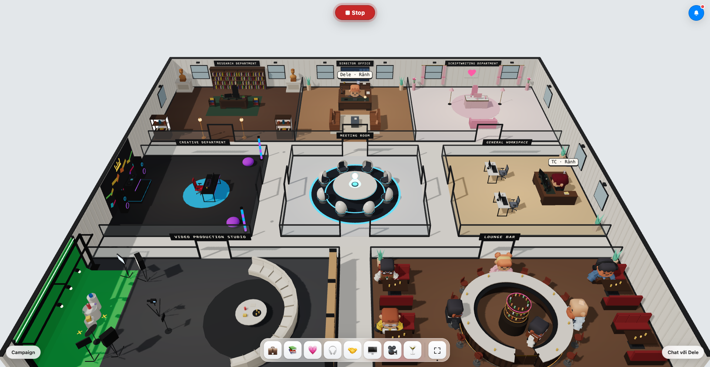

# Dele Banana — Virtual AI Marketing Agency

> **Tài liệu phân tích sản phẩm & Trạng thái dự án.**  
> Tech stack: TypeScript full-stack, Three.js qua React Three Fiber, Hono + SQLite, pnpm workspace.  
> Cập nhật tiến độ: **2026-11-24** (Giai đoạn 1 & 2 hoàn tất; Giai đoạn 3 Triển khai MVP cốt lõi đạt 589 tests vitest pass).

---

  

## Cách hiểu sản phẩm

Dele Banana là một **công ty Marketing ảo**: người dùng đóng vai chủ công ty, giao chiến dịch cho một
**Director Agent** qua khung chat; Director bàn giao cho **Coordinator Agent**, người chia việc cho các
**Agent chuyên môn** (nghiên cứu, sáng tạo, viết kịch bản, sản xuất video, đăng bài, phân tích). Toàn bộ
quy trình — nghiên cứu → brainstorm/kịch bản → sản xuất video 9:16 → duyệt và đăng TikTok/Facebook/Instagram →
phân tích hiệu suất — chạy qua các Agent, với các điểm dừng chờ người dùng phê duyệt.

Khác biệt cốt lõi: Agent không chỉ là chatbot hay danh sách việc, mà là "nhân viên" có tên, ngoại hình, vai trò,
model/provider, system prompt, tools, memory, permissions, trạng thái và nhiệm vụ hiện tại, hiện diện trong một
**văn phòng 3D isometric (Stylized 3D)**. Mọi hành động/animation của nhân vật là hiển thị của trạng thái thật
trong backend thông qua Event Bus (SSE), không phải chuyển động ngẫu nhiên (xem [boundaries.md](boundaries.md)).

## Ba trụ cột

| Trụ cột | Ý nghĩa | Module chính (xem [modules.md](modules.md)) | Hiện trạng (2026-11-24) |
|---|---|---|---|
| **AI Agent Orchestration** | Agent phối hợp, giao việc, trao đổi, đánh giá và làm lại; Director là đầu mối duy nhất với người dùng | Orchestration Engine, Agent Registry, CLI Harness Gateway, Memory | Đã triển khai Engine điều phối, CLI Harness (Claude Code), vòng đời Task/Campaign |
| **3D Virtual Office** | Trực quan hóa trạng thái thật của Agent trong văn phòng 3D, click nhân vật để mở bảng thông tin và kiểm soát | Event Bus & Realtime, 3D Virtual Office, Dashboard UI | Hoàn thiện văn phòng 3D 8 phòng (6 khu vực chức năng + Director Office, Lounge Bar) cân đối, animation trạng thái, di chuyển qua hành lang, Dock phòng, bảng duyệt |
| **Marketing Automation** | Tự động hóa nghiên cứu, ý tưởng, video, đăng bài, phân tích bằng API chính thức | Campaign & Content, Video Production Pipeline, Publishing & Social Accounts, Analytics | Hoàn thiện luồng sinh 3 kịch bản, quy trình duyệt video, đăng Facebook & Instagram Reels qua Meta Graph API |

Ba lớp ngang đi qua cả ba trụ cột: Identity & Workspace, Cost Management, Audit & Governance.

## Thuật ngữ

| Thuật ngữ | Định nghĩa |
|---|---|
| Workspace | Ranh giới tổ chức theo thương hiệu/sản phẩm/dự án; chứa Agent, Campaign, tài khoản social, ngân sách |
| Campaign | Một chiến dịch Marketing trong Workspace; ranh giới phân tách bộ nhớ |
| Agent | Nhân viên AI với cấu hình độc lập (vai trò, provider/model, prompt, tools, memory, permissions, ngoại hình) |
| Task | Đơn vị công việc Coordinator giao cho một Agent, có trạng thái, đầu ra và vòng đánh giá |
| Approval | Điểm dừng chờ người dùng quyết định (chọn kịch bản, duyệt video, duyệt đăng, hành động ngoài quyền) |
| Phiên bản video | Mỗi lần sinh/chỉnh sửa/tạo lại một video là một phiên bản mới của cùng video |

## Cấu trúc thư mục tài liệu

1. **Phân tích sản phẩm (`docs/product/`):**
   - [modules.md](modules.md) — 14 module chính và bảng truy vết tính năng gốc → module.
   - [boundaries.md](boundaries.md) — ranh giới AI Agent / API bên ngoài / backend / hoạt ảnh 3D; ánh xạ trạng thái → khu vực → animation.
   - [platform-limits.md](platform-limits.md) — giới hạn TikTok, Facebook, Instagram, dịch vụ AI Video Generation.
   - [risks.md](risks.md) — rủi ro kỹ thuật, chính sách nền tảng, chi phí, sản phẩm.
   - [roadmap.md](roadmap.md) — lộ trình tổng thể và 18 quyết định kỹ thuật đã chốt (D-1..D-18).
2. **Thiết kế kỹ thuật (`docs/design/`):**
   - [01-domain-model.md](../design/01-domain-model.md) — Mô hình dữ liệu thực thể.
   - [02-lifecycle-events.md](../design/02-lifecycle-events.md) — Vòng đời trạng thái và hợp đồng sự kiện.
   - [03-permissions-approvals-audit.md](../design/03-permissions-approvals-audit.md) — Quyền hạn, phê duyệt, nhật ký kiểm toán.
   - [04-memory.md](../design/04-memory.md) — Thiết kế bộ nhớ Agent theo Campaign.
   - [05-office-decor.md](../design/05-office-decor.md) — Bộ quy tắc đối xứng và bài trí nội thất văn phòng 3D.
3. **Hướng dẫn & Khảo sát (`docs/guides/`, `docs/research/`):**
   - [meta-app-setup.md](../guides/meta-app-setup.md) — Hướng dẫn tạo Meta App và kết nối Instagram Reels.
   - [2026-11-23-next-steps-video-publish.md](../research/2026-11-23-next-steps-video-publish.md) — Nghiên cứu tích hợp video & xuất bản.
   - [2026-11-18-s5-cli-spike.md](../research/2026-11-18-s5-cli-spike.md) — Kết quả khảo sát CLI.
4. **Kế hoạch triển khai Superpowers (`docs/superpowers/plans/`):**
   - Toàn bộ các kế hoạch triển khai đã hoàn thành: Backend Foundation, Domain Lifecycle, Agent Runtime, Campaign Flow, Instagram API Publish.

## Phạm vi và tiến độ hiện tại

- Toàn bộ các giai đoạn Spike (S1..S5) và Thiết kế (TK1..TK5) đã được nghiệm thu.
- Triển khai MVP: Bộ mã nguồn hoàn chỉnh tại `packages/domain`, `apps/server`, và `apps/web` đã được kiểm thử với **54 files kiểm thử** và **589 bài test** đạt kết quả tuyệt đối.
